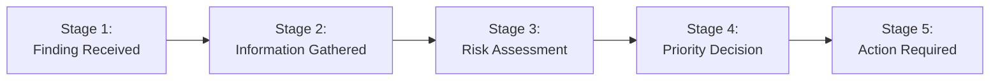

# VPAP Audit Trail UI: Comprehensive Architectural & Component Study Guide

## 1. Why Do We Need the VPAP Audit UI?

Security tools produce thousands of vulnerability alerts. In traditional vulnerability management, decisions are treated like a "black box":
- Why was a Critical CVE downgraded to P3?
- Why was a Medium CVE elevated to P0 emergency remediation?
- Who made the decision (an automated policy engine, an LLM, or a human engineer)?
- What evidence was used at that exact moment in time?

Regulators (SOC 2 Type II, ISO 27001, FedRAMP, PCI-DSS 4.0) and corporate risk committees require **non-repudiable audit trails** proving that vulnerability prioritization decisions were mathematically sound, policy-driven, and based on verifiable telemetry.

The **VPAP Audit UI** solves this by converting raw database records into a **transparent, dual-perspective audit platform**:
1. **The Executive & Compliance Story (`Customer Audit Story`)**: A clear, non-jargon, 5-stage chronological timeline certifying what happened to a single vulnerability finding.
2. **The Security Engineer Telemetry (`Live Operational Feed` & `Technical Details`)**: A high-frequency, real-time stream of every immutable state change across the distributed ingestion, enrichment, and policy engines.

---

## 2. System Architecture & Data Flow

```mermaid
flowchart TD
    subgraph Data Layer (Supabase / PostgreSQL)
        A1[(finding_instance)]
        A2[(asset_contexts)]
        A3[(finding_evidence)]
        A4[(priority_decision)]
        A5[(ticket_link)]
        A6[(audit_event)]
    end

    subgraph Backend Layer (FastAPI)
        B1["GET /finding-history/{id}\n(Requires Bearer JWT)"]
        B2["GET /live-audit-feed\n(Server-Side Proxy / Read API)"]
    end

    subgraph Frontend Application (React + Vite + Tailwind)
        C1["App.tsx\n(State Orchestrator & View Switcher)"]
        
        subgraph View 1: Customer Audit Story
            D1["SummaryHeader\n(CVE Identity & Host Badges)"]
            D2["CustomerSummary\n(Plain-English Executive Brief)"]
            D3["VisualTimeline\n(5-Stage Pipeline)"]
            D4["EvidenceSourceMap\n(Source Provenance)"]
            D5["AuditHistoryTimeline\n(Ledger of Events)"]
            D6["TechnicalDetailsAccordion\n(Raw JSON & Hashes)"]
        end

        subgraph View 2: Live Operational Feed
            E1["LiveAuditMonitor\n(3s Polling Stream & Filter Bar)"]
        end

        subgraph Modals & Utilities
            F1["ExportReportModal\n(PDF / JSON Export)"]
            F2["translator.ts\n(Formatting & Humanizer)"]
        end
    end

    A1 & A2 & A3 & A4 & A5 & A6 --> B1
    A6 --> B2
    B1 -->|AuditRecordPayload| C1
    B2 -->|Live Stream Array| E1
    C1 --> D1 & D2 & D3 & D4 & D5 & D6
    C1 --> F1
```

---

## 3. Deep-Dive Component Breakdown

### 1. State Orchestrator (`App.tsx`)
- **What it does**: Acts as the central root controller for the user interface. It manages:
  - **View Switching**: Toggles between `STORY` (Customer Audit Story) and `LIVE_FEED` (Live Operational Feed).
  - **Data Mode**: Toggles between synthetic demo presets (`selectedScenario`) and live production data connected to the API (`isLiveMode`).
  - **Live Auto-Sync**: Runs a background interval (every 15s) when connected to a live record to notify the user if new audit events were registered.
- **Why we need it**: Ensures strict boundary separation between offline demo walkthroughs (where no real customer credentials exist) and live customer audits, preventing accidental leakage or confusion.

---

### 2. Top Header & Control Bar (`HeaderControls.tsx`)
- **What it does**: 
  - Hosts the global search input.
  - Houses the **Stage Filter** dropdown (`All Stages`, `Stage 1`, `Stage 2`, etc.), allowing users to focus on specific phases.
  - Houses the **Scenario Preset Selector** (e.g. *CVE-2025-XXXX (Unreachable Attack Path -> P3)* vs *CVE-2026-99001 (Active RCE -> P0)*).
  - Contains quick-action buttons: **Live Mode toggle**, **Refresh**, and **Export Report**.
- **Why we need it**: Provides immediate situational context. Auditors can filter out stages they do not need (e.g., jump directly to policy execution) or switch between standard edge cases in seconds.

---

### 3. Executive Identity Banner (`SummaryHeader.tsx`)
- **What it does**:
  - Highlights the public CVE ID (`cve_id`) and natural language description.
  - Renders a color-coded top accent bar indicating operational priority (`P0` red, `P1` orange, `P2` amber, `P3` emerald).
  - Displays **Target Asset & Canonical Host Context (ACS)**: Asset ID, Hostname (`UAT-API-0250`), IP Address (`172.16.28.89`), Environment (`UAT`/`Production`), Criticality, and Owner Team.
  - Renders 3 quick metric tiles: Current Status, Final Priority, and SLA Deadline.
- **Why we need it**: In high-stakes meetings with CISOs or compliance auditors, users must immediately establish **what** vulnerability is affected, **where** it lives in the infrastructure, and **when** it must be resolved.

---

### 4. Plain-English Executive Summary (`CustomerSummary.tsx`)
- **What it does**:
  - Translates complex risk formulas into a clean 2-paragraph narrative titled **"What happened?"**.
  - Renders key conclusion cards evaluating:
    1. Active exploitation status from the CISA KEV catalogue.
    2. Network reachability of the affected host.
    3. Business asset importance.
    4. Remediation enforcement mandate.
  - Flags missing or unverified data explicitly (`Confidence not available — flagged for verification`) without treating it as an automatic negative.
- **Why we need it**: Non-technical stakeholders (auditors, risk officers, executives) often cannot interpret raw CVSS vector strings like `CVSS:3.1/AV:N/AC:L/PR:N/UI:N/S:U/C:H/I:H/A:H`. This component delivers a defensible summary that anyone can understand.

---

### 5. 5-Stage Visual Lifecycle Pipeline (`VisualTimeline.tsx`)

The timeline breaks the vulnerability journey into 5 distinct sequential stages:



#### Stage 1: Finding Received (`Stage1FindingReceived.tsx`)
- **Telemetry**: Scanner name (`source_system` = Wiz/Snyk), scanner finding ID, CVE ID, affected host/asset ID, first detected timestamp, ingestion validation status.
- **Purpose**: Establishes **provenance at the gate**. Proves when and where the finding originated.

#### Stage 2: Information Gathered (`Stage2InformationGathered.tsx`)
- **Telemetry**: 
  - **Canonical ACS Host Card**: Operating platform (`platform_os`), IP address, network exposure, owner team, and software packages.
  - **Threat Intelligence Grid**: EPSS exploit likelihood (with confidence rating), CISA KEV status, Internet exposure, Business criticality, and Attack path reachability.
- **Purpose**: Solves the "stale snapshot" problem. Captures the state of threat intelligence and host configuration at the time the decision was made.

#### Stage 3: Risk Assessment (`Stage3RiskAssessment.tsx`)
- **Telemetry**: Compares raw scanner severity (CVSS 8.8/9.8) against contextual environmental risk factors. Evaluates attack vector reachability against exploit availability.
- **Purpose**: Explains the divergence between generic scanner scores and realistic organizational danger.

#### Stage 4: Priority Decision (`Stage4PriorityDecision.tsx`)
- **Telemetry**: The active policy version (`policy_version`), assigned operational priority (`P0` through `P3`), SSVC decision outcome (`ACT`, `ATTEND`, `TRACK`), applied rule codes (e.g., `SSVC.ATTACK_PATH.NOT_REACHABLE`, `CISA_KEV.MANDATORY_REMEDIATION`), and conservative floor safeguards.
- **Purpose**: The core logic audit. Demonstrates that decisions are reproducible and governed by versioned rulebooks rather than human whim.

#### Stage 5: Action Required (`Stage5FinalAction.tsx`)
- **Telemetry**: Mandatory remediation indicator, SLA countdown timeline, connected Jira/ServiceNow ticket link, ticket status, assigned engineering team.
- **Purpose**: Closes the loop from decision to operational remediation.

---

### 6. Evidence Provenance & Source Map (`EvidenceSourceMap.tsx`)
- **What it does**: A 4-column intelligence tracing grid mapping source systems (EPSS Model v3, CISA KEV Catalogue, Canonical CMDB / ACS, Security Data Engine) to their evaluated risk attributes, confidence grades, and exact retrieval timestamps.
- **Why we need it**: Regulators require proof of source authority and data freshness. If a decision relied on an external database, this component certifies the exact feed and timestamp queried.

---

### 7. Immutable Audit Ledger (`AuditHistoryTimeline.tsx`)
- **What it does**: Displays the chronological event stream from `public.audit_event`. Lists every recorded action (`finding_instance.created`, `enrichment_run.completed`, `priority_decision.completed`, `asset_context.created`), actor ID, actor type (`system`, `human`, `llm`), and correlation UUID.
- **Why we need it**: Delivers non-repudiation. Proves that no step was skipped or retroactively manipulated.

---

### 8. Technical Telemetry Drawer (`TechnicalDetailsAccordion.tsx`)
- **What it does**: A dark-mode drawer at the bottom of the page providing:
  - **Structured Fields View**: Direct access to `finding_id`, `asset_id`, `acs_hostname`, `tenant_id`, `decision_id`, `evidence_snapshot_id`, and policy digest.
  - **Raw JSON View**: Formatted JSON representation of the entire finding record with syntax highlighting and a 1-click clipboard copy button.
- **Why we need it**: Security engineers and API developers need access to exact UUIDs, cryptographic digests, and raw payloads for SIEM integrations and API debugging.

---

### 9. Live Operational Stream (`LiveAuditMonitor.tsx`)
- **What it does**:
  - Automatically polls `/live-audit-feed` every 3 seconds.
  - Displays a system-wide, multi-tenant feed of all incoming audit events.
  - Features real-time filters by **Tenant**, **Entity Type**, and **Action**.
  - Includes pulse animations for newly arriving rows and an expandable side-drawer displaying raw event states (`before_state` vs `after_state`).
- **Why we need it**: Real-time SOC monitor. Security operations centers can keep this open on dashboard monitors to observe live ingestion, enrichment runs, and policy decisions happening across all tenants in real time.

---

### 10. Executive Compliance Certification Export (`ExportReportModal.tsx`)
- **What it does**:
  - Generates a certified executive audit report preview.
  - Features a **Download JSON** button for automated archival.
  - Features a **Print Executive PDF** button with tailored `@media print` CSS that strips navigation bars, formats tables cleanly, and creates an official PDF record.
- **Why we need it**: Security leaders must provide signed evidence artifacts to external SOC 2 and ISO auditors during annual compliance reviews.

---

## 4. Key Design Patterns & Engineering Highlights

| Pattern | Implementation | Benefit |
|---|---|---|
| **Zero-Token Live Feed** | Vite dev server proxy routes `/live-audit-feed` server-side | Browser never handles raw master secrets; credentials remain secure on server |
| **Defensive Null Handling** | `formatEvidenceValue` in `translator.ts` converts missing/stale values to `"Not available — flagged for verification"` | Prevents false negative assumptions and UI runtime crashes |
| **Multi-Tenant Isolation** | All SQL queries and API endpoints enforce `tenant_id = auth.tenant_id` | Guarantees that tenants cannot cross-read audit logs or host data |
| **Separation of Concerns** | Split between Executive Narrative (`CustomerSummary`) and Technical Telemetry (`TechnicalDetailsAccordion`) | Satisfies both non-technical compliance auditors and hands-on security engineers |
